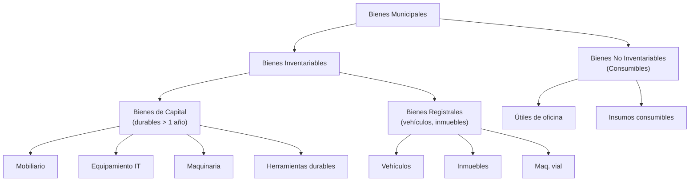
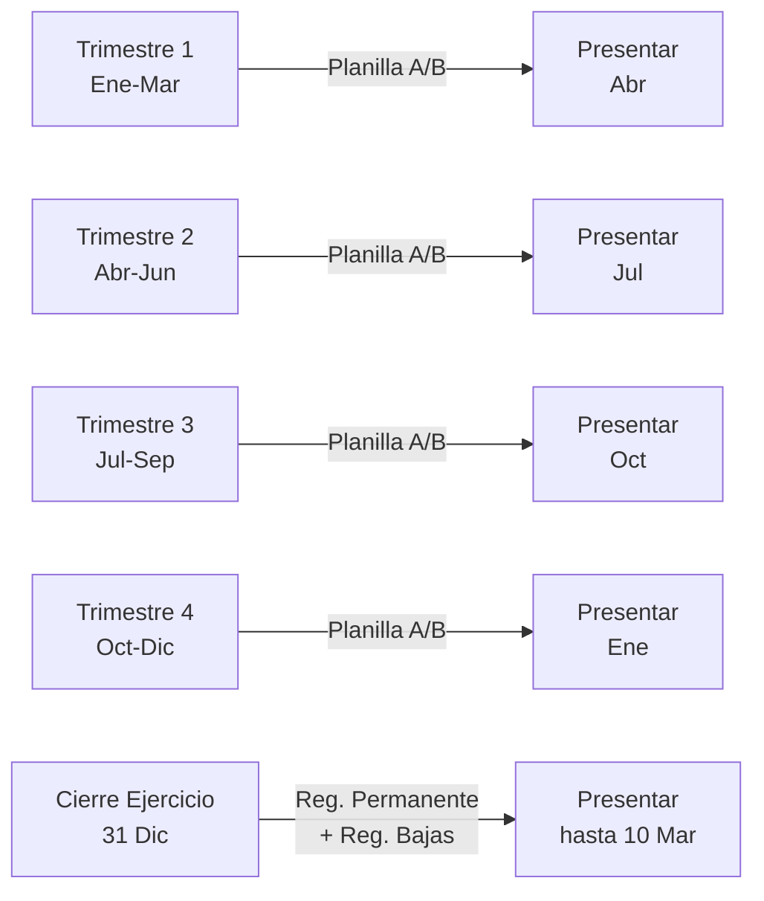

# 📋 Planificación: Sistema de Gestión Patrimonial — Municipalidad de Garupá

## Resumen Ejecutivo

Este documento planifica el desarrollo de un **Sistema de Gestión Patrimonial** para el área de Patrimonio de la Municipalidad de Garupá, alineado a los lineamientos del **Honorable Tribunal de Cuentas de la Provincia de Misiones** (Ley Orgánica del HTC, Art. 43 y Resolución N° 3).

El sistema se construirá sobre la misma arquitectura del proyecto `inventario_garupa_nest` (NestJS + Prisma + MySQL para el backend, React + MUI para el frontend), reutilizando patrones probados y adaptándolos a las necesidades específicas de patrimonio.

---

## 1. Contexto y Marco Normativo

### 1.1 Normativa aplicable
- **Ley Orgánica del Tribunal de Cuentas de Misiones**, Art. 43
- **Resolución N° 3 del HTC** (modelos de libros obligatorios)
- **Rúbrica digital de libros contables** (vigente desde diciembre 2025)

### 1.2 Tres registros obligatorios según el HTC

| Registro | Contenido | Presentación | Frecuencia |
|---|---|---|---|
| **Planilla de Altas y Bajas** | Altas (fecha acta recepción) y bajas (fecha dispositivo legal) por separado | Trimestral | 11 días hábiles (1ra cat.) / 45 días corridos (2da cat.) tras cierre del trimestre |
| **Registro Permanente de Inventario** | Todos los bienes **en existencia** al cierre del ejercicio | Anual | Hasta el 10 de marzo del ejercicio siguiente |
| **Registro de Bajas (Inventario Histórico)** | Bajas de los **últimos 10 años** contados al cierre del ejercicio | Anual | Hasta el 10 de marzo del ejercicio siguiente |

### 1.3 Principios clave del HTC

> [!IMPORTANT]
> El Tribunal de Cuentas remarcó que **registrar no alcanza**. Se necesita una **gestión patrimonial completa** que garantice trazabilidad, cadena de custodia, y coherencia entre el registro y la realidad física.

1. **Existencia física verificada** — el bien debe estar
2. **Identificación unívoca** — código único e inalterable (QR, código de barras), nunca reutilizable
3. **Registración** — en los tres libros obligatorios
4. **Responsables y subresponsables** — con dispositivo firmado
5. **Ubicación física** — por escrito, no de memoria
6. **Control periódico** — mínimo 1-2 veces al año

---

## 2. Alcance Funcional del Sistema

### 2.1 Bienes que gestiona el sistema



### 2.2 Módulos del sistema

#### Módulo 1 — Gestión de Bienes Inventariables (Core)
- Alta de bienes con código único autogenerado (no reutilizable)
- Descripción detallada obligatoria (marca, modelo, material, medidas, Nº motor/patente para vehículos)
- Clasificación por **rubro contable** (Mobiliario, Equipamiento, Rodados, Maquinaria, Inmuebles, etc.)
- Estado del bien (En uso, En reparación, En depósito, Dado de baja)
- Valor histórico de incorporación (precio de compra o valor de referencia para donaciones)
- Tipo de incorporación (Compra, Donación, Préstamo, Transferencia de otro organismo)
- Documentación asociada: factura de compra, acta de recepción, decreto de donación, etc.
- Generación e impresión de etiquetas con código QR/barras

#### Módulo 2 — Cadena de Custodia y Subresponsables
- Registro de **Encargado de Patrimonio** y **Subresponsables** por bien
- Asignación de bien a subresponsable con generación del **Dispositivo de Designación** (acta firmable)
- Transferencia de bienes entre subresponsables (con acta de entrega/recepción)
- Historial completo de custodia por bien (quién tuvo el bien, desde cuándo, hasta cuándo)
- PDF de acta de asignación para firma

#### Módulo 3 — Ubicación Física
- Catálogo de **Áreas/Dependencias** de la municipalidad (con dirección si corresponde)
- Asignación de bien a área con registro de movimientos
- Historial de ubicaciones por bien
- Búsqueda de bienes por ubicación

#### Módulo 4 — Altas y Bajas
- **Altas**: registro con fecha de acta de recepción, generación del alta automática en registro permanente
- **Bajas**: registro con fecha de dispositivo legal (resolución del intendente), motivo de baja, y destino del bien (donación, desguace, destrucción, etc.)
- Impedimento de reutilización del código de inventario de bienes dados de baja
- Baja del subresponsable al dar de baja el bien

#### Módulo 5 — Gestión de Compras y Entregas
- Registro de órdenes de compra / expedientes de compra
- Vinculación de la compra con los bienes que ingresan
- Acta de recepción de bienes (con firma del encargado de patrimonio)
- Registro de entregas a áreas/subresponsables
- Control de documentación respaldatoria por compra (factura, remito, orden de pago)

#### Módulo 6 — Bienes No Inventariables (Consumibles)
- Registro de insumos consumibles (útiles de oficina, material de limpieza, etc.)
- Control de stock básico (entradas y salidas)
- Entregas a áreas con registro de movimientos
- Alertas de stock mínimo
- El HTC pide "cuidar y evitar despilfarro" aunque no van al inventario formal

#### Módulo 7 — Reportes y Libros Obligatorios

> [!IMPORTANT]
> Este módulo es **crítico**: debe generar los tres registros obligatorios en el formato que exige el HTC para su presentación digital con rúbrica.

| Reporte | Detalle |
|---|---|
| **Planilla de Altas** | Bienes dados de alta en el trimestre, ordenados por fecha, agrupados por rubro |
| **Planilla de Bajas** | Bienes dados de baja en el trimestre, ordenados por fecha |
| **Registro Permanente de Inventario** | Todos los bienes en existencia al cierre, por rubro y en orden cronológico, con totales por rubro y total general |
| **Registro de Bajas Histórico** | Bajas de los últimos 10 años, por rubro y en orden cronológico |
| **Conciliación contable** | Total del registro permanente vs. saldo de Activos No Corrientes / Bienes de Capital del Balance Patrimonial |
| **Acta de cambio de responsable** | Para transiciones de gestión |
| **Listado de bienes por área** | Para verificaciones físicas |
| **Listado de bienes por subresponsable** | Para control de custodia |
| **Reporte de bienes en préstamo** | Bienes que no son patrimonio propio (cuentas de orden) |

Formatos de exportación: **Excel** (compatible con modelos del HTC) y **PDF**.

#### Módulo 8 — Verificación Física e Inspecciones
- Creación de campañas de verificación (inventario físico)
- Checklist por área: marcar bienes encontrados vs. registro
- Detección de faltantes y sobrantes
- Generación de informe de discrepancias
- Registro de estado del bien en la verificación

#### Módulo 9 — Siniestros y Eventos Especiales
- Registro de siniestros (robo, incendio, accidente)
- Alerta de obligación de notificar al HTC dentro de los 3 días
- Documentación asociada (denuncia policial, comprobantes de seguro)
- Vinculación con baja del bien si corresponde

#### Módulo 10 — Auditoría y Seguridad
- Log de todas las operaciones (quién hizo qué, cuándo)
- Roles: Administrador, Encargado de Patrimonio, Consulta
- Firma digital / registro de aceptación del subresponsable

---

## 3. Modelo de Datos (Diseño Conceptual)

```mermaid
erDiagram
    BIENES ||--o{ MOVIMIENTOS_CUSTODIA : tiene
    BIENES ||--o{ MOVIMIENTOS_UBICACION : tiene
    BIENES ||--o{ DOCUMENTOS : respaldado_por
    BIENES ||--o{ VERIFICACIONES_DETALLE : verificado_en
    BIENES }o--|| RUBROS : clasificado_en
    BIENES }o--|| ESTADOS_BIEN : tiene_estado
    BIENES }o--o| COMPRAS : ingresa_por
    BIENES }o--o| AREAS : ubicado_en
    BIENES }o--o| PERSONAS : subresponsable

    BIENES {
        int id PK
        string codigo_inventario UK "Único, no reutilizable"
        string descripcion "Detallada"
        string marca
        string modelo
        string numero_serie
        string numero_motor "Vehículos"
        string numero_patente "Vehículos"
        string material
        string medidas
        string color
        int rubro_id FK
        int estado_id FK
        int area_id FK
        int subresponsable_id FK
        string tipo_incorporacion "Compra/Donación/Préstamo"
        decimal valor_historico
        date fecha_alta
        date fecha_baja
        string motivo_baja
        string destino_baja
        string resolucion_baja
        bool es_prestamo
        bool activo
    }

    RUBROS {
        int id PK
        string nombre "Mobiliario, Rodados, etc."
        string cuenta_contable
    }

    ESTADOS_BIEN {
        int id PK
        string nombre "En uso, En reparación, etc."
    }

    AREAS {
        int id PK
        string nombre
        string direccion
        int responsable_id FK
    }

    PERSONAS {
        int id PK
        string nombre
        string apellido
        string dni
        string cargo
        int area_id FK
    }

    COMPRAS {
        int id PK
        string numero_expediente
        date fecha_compra
        string proveedor
        string numero_factura
        string numero_orden_pago
        decimal monto_total
    }

    COMPRAS ||--o{ COMPRAS_DETALLE : contiene
    COMPRAS_DETALLE }o--|| BIENES : es_bien

    COMPRAS_DETALLE {
        int id PK
        int compra_id FK
        int bien_id FK
        decimal precio_unitario
        int cantidad
    }

    MOVIMIENTOS_CUSTODIA {
        int id PK
        int bien_id FK
        int persona_origen_id FK
        int persona_destino_id FK
        date fecha
        string tipo "Asignación/Transferencia/Devolución"
        string observaciones
    }

    MOVIMIENTOS_UBICACION {
        int id PK
        int bien_id FK
        int area_origen_id FK
        int area_destino_id FK
        date fecha
        string motivo
    }

    DOCUMENTOS {
        int id PK
        int bien_id FK
        string tipo "Factura/Acta Recepción/Resolución Baja/etc."
        string numero
        date fecha
        string archivo_path
    }

    VERIFICACIONES ||--o{ VERIFICACIONES_DETALLE : incluye
    VERIFICACIONES {
        int id PK
        string nombre_campania
        date fecha_inicio
        date fecha_fin
        string estado
    }

    VERIFICACIONES_DETALLE {
        int id PK
        int verificacion_id FK
        int bien_id FK
        bool encontrado
        string estado_fisico
        string observaciones
    }

    CONSUMIBLES ||--o{ MOVIMIENTOS_CONSUMIBLES : tiene
    CONSUMIBLES {
        int id PK
        string nombre
        string categoria
        string unidad_medida
        int stock_actual
        int stock_minimo
    }

    MOVIMIENTOS_CONSUMIBLES {
        int id PK
        int consumible_id FK
        int area_destino_id FK
        string tipo "Ingreso/Entrega/Ajuste"
        int cantidad
        date fecha
        int usuario_id FK
    }

    SINIESTROS {
        int id PK
        int bien_id FK
        date fecha_siniestro
        string tipo "Robo/Incendio/Accidente"
        string descripcion
        bool notificado_htc
        date fecha_notificacion_htc
        string numero_denuncia
    }

    USUARIOS {
        int id PK
        string nombre
        string apellido
        string usuario UK
        string password_hash
        string rol "Admin/Patrimonio/Consulta"
    }

    AUDITORIA {
        int id PK
        int usuario_id FK
        string entidad
        string accion
        string datos_anteriores
        string datos_nuevos
        datetime fecha
    }
```



---

## 4. Arquitectura Técnica

### 4.1 Stack tecnológico (heredado de inventario_garupa_nest)

| Capa | Tecnología | Versión |
|---|---|---|
| **Backend** | NestJS | 11.x |
| **ORM** | Prisma | 5.x |
| **Base de datos** | MySQL / MariaDB | — |
| **Frontend** | React | 19.x |
| **UI Framework** | Material UI (MUI) | 7.x |
| **Generación PDF** | pdfmake | 0.2.x |
| **Gráficos** | Recharts | 3.x |
| **HTTP Client** | Axios | — |
| **Package Manager** | pnpm | — |

### 4.2 Estructura del proyecto

```
patrimonio_garupa_nest/
├── back/
│   ├── prisma/
│   │   └── schema.prisma          # Modelo de datos completo
│   ├── src/
│   │   ├── main.ts
│   │   ├── app.module.ts
│   │   ├── auth/                  # Autenticación
│   │   ├── bienes/                # CRUD bienes inventariables
│   │   ├── areas/                 # Áreas/dependencias
│   │   ├── personas/              # Subresponsables y personal
│   │   ├── compras/               # Gestión de compras
│   │   ├── custodia/              # Cadena de custodia
│   │   ├── consumibles/           # Bienes no inventariables
│   │   ├── verificaciones/        # Inspecciones físicas
│   │   ├── siniestros/            # Registro de siniestros
│   │   ├── reportes/              # Generación de libros HTC
│   │   └── auditoria/             # Log de operaciones
│   └── package.json
└── front/
    ├── src/
    │   ├── components/
    │   │   ├── bienes/            # ABM + listado de bienes
    │   │   ├── areas/             # Config áreas
    │   │   ├── personas/          # Subresponsables
    │   │   ├── compras/           # Registro compras + actas recepción
    │   │   ├── entregas/          # Entregas a áreas
    │   │   ├── consumibles/       # Gestión consumibles
    │   │   ├── verificaciones/    # Campañas de inventario físico
    │   │   ├── reportes/          # Libros HTC + informes
    │   │   └── dashboard/         # Panel principal
    │   ├── pdf/                   # Generadores de documentos PDF
    │   │   ├── ActaRecepcion.js
    │   │   ├── DispositivoSubresponsable.js
    │   │   ├── ActaTransferencia.js
    │   │   ├── PlanillaAltasBajas.js
    │   │   ├── RegistroPermanente.js
    │   │   ├── RegistroBajasHistorico.js
    │   │   └── ListadoBienesArea.js
    │   └── context/
    └── package.json
```

---

## 5. Plan de Desarrollo por Fases

### Fase 1 — Cimientos (Semanas 1-3)

> [!NOTE]
> Esta fase establece la base del sistema. Sin ella, nada funciona.

- [ ] Crear el repositorio `patrimonio_garupa_nest`
- [ ] Configurar el proyecto NestJS + Prisma + React (clonar estructura del inventario existente)
- [ ] Diseñar e implementar el schema de Prisma completo
- [ ] Módulo de **Autenticación** (login, roles: Admin, Patrimonio, Consulta)
- [ ] CRUD de **Áreas/Dependencias**
- [ ] CRUD de **Personas** (subresponsables)
- [ ] CRUD de **Rubros contables**
- [ ] CRUD de **Estados de bien**
- [ ] Layout principal, navegación, dashboard vacío

### Fase 2 — Gestión de Bienes (Semanas 4-6)

- [ ] CRUD de **Bienes Inventariables** con toda la info requerida por el HTC
- [ ] Generación automática de código de inventario único (no reutilizable)
- [ ] Alta de bien con documentación asociada (subir archivos o registrar referencia)
- [ ] Baja de bien con resolución, motivo y destino
- [ ] Generación de etiquetas QR para impresión
- [ ] Filtros y búsqueda avanzada de bienes (por rubro, área, estado, subresponsable, código)

### Fase 3 — Cadena de Custodia (Semanas 7-8)

- [ ] Asignación de bien a subresponsable
- [ ] Transferencia entre subresponsables
- [ ] Historial de custodia por bien
- [ ] Generación de PDF: **Dispositivo de Designación de Subresponsable**
- [ ] Generación de PDF: **Acta de Transferencia**
- [ ] Generación de PDF: **Acta de Recepción de bienes**

### Fase 4 — Compras y Entregas (Semanas 9-10)

- [ ] Registro de compras con detalle de bienes adquiridos
- [ ] Vinculación compra → bienes que ingresan
- [ ] Registro de entregas a áreas
- [ ] Documentación respaldatoria por compra

### Fase 5 — Consumibles (Semana 11)

- [ ] CRUD de productos consumibles
- [ ] Registro de ingresos (compras) y salidas (entregas a áreas)
- [ ] Alertas de stock mínimo
- [ ] Reporte de consumo por área

### Fase 6 — Reportes y Libros HTC (Semanas 12-14)

> [!WARNING]
> Los reportes deben coincidir **exactamente** con los modelos Excel del HTC disponibles en el portal del Cuentadante, pestaña "Recursos", sección "Rubro". Obtener esos modelos antes de desarrollar.

- [ ] **Planilla de Altas** (trimestral, por fecha, separada)
- [ ] **Planilla de Bajas** (trimestral, por fecha, separada)
- [ ] **Registro Permanente de Inventario** (anual, por rubro, cronológico, con totales)
- [ ] **Registro de Bajas Histórico** (anual, últimos 10 años, por rubro, cronológico)
- [ ] Reporte de conciliación contable (total bienes vs. balance patrimonial)
- [ ] Listado de bienes por área y por subresponsable
- [ ] Reporte de bienes en préstamo
- [ ] Acta de cambio de responsable (para transición de gestión)
- [ ] Exportación a Excel y PDF

### Fase 7 — Verificaciones y Siniestros (Semanas 15-16)

- [ ] Módulo de campañas de verificación física
- [ ] Checklist de bienes por área (encontrado / no encontrado / estado)
- [ ] Informe de discrepancias
- [ ] Registro de siniestros con alerta de 3 días para notificar al HTC
- [ ] Dashboard con indicadores clave

### Fase 8 — Auditoría, Pulido y Deploy (Semanas 17-18)

- [ ] Log de auditoría completo (todas las operaciones)
- [ ] Dashboard final con KPIs:
  - Total bienes activos por rubro
  - Bienes sin subresponsable asignado
  - Bienes próximos a verificación
  - Alertas de stock mínimo de consumibles
  - Siniestros sin notificar al HTC
- [ ] Testing integral
- [ ] Deploy en servidor municipal

---

## 6. Documentos PDF a Generar

Usando `pdfmake` (como en el proyecto actual), el sistema debe generar:

| Documento | Uso |
|---|---|
| **Acta de Recepción** | Firma del encargado de patrimonio al recibir bienes |
| **Dispositivo de Designación de Subresponsable** | Firma de quien entrega y quien recibe el bien |
| **Acta de Transferencia** | Cambio de subresponsable o de área |
| **Acta de Cambio de Responsable** | Para transición de gestión municipal |
| **Planilla de Altas y Bajas** | Presentación trimestral al HTC |
| **Registro Permanente de Inventario** | Presentación anual al HTC |
| **Registro de Bajas Histórico** | Presentación anual al HTC (10 años) |
| **Listado de bienes por área** | Para verificaciones físicas |
| **Informe de verificación** | Resultado de inspección física |
| **Etiqueta con QR** | Para pegar en cada bien |

---

## 7. Diferencias clave con el proyecto de Informática

| Aspecto | `inventario_garupa_nest` (Informática) | Sistema de Patrimonio (nuevo) |
|---|---|---|
| **Alcance** | Equipos IT, tintas, repuestos | Todos los bienes municipales |
| **Normativa** | Interna del área | HTC Misiones (3 libros obligatorios) |
| **Identificación** | Número de PC + serie | Código único con QR, no reutilizable |
| **Responsabilidad** | Usuario del equipo | Cadena formal de subresponsables con firma |
| **Ubicación** | Área simple | Dependencia con historial de movimientos |
| **Compras** | No tiene módulo de compras | Registro completo con documentación |
| **Bajas** | No contempla | Con resolución del intendente, motivo y destino |
| **Consumibles** | Tintas y cartuchos | Todos los bienes no inventariables |
| **Reportes** | Auditoría interna | Libros oficiales para el HTC con rúbrica digital |
| **Verificación física** | No tiene | Campañas de inventario con checklist |

---

## 8. Riesgos y Consideraciones

> [!CAUTION]
> **Riesgo principal**: Los modelos de libros del HTC pueden cambiar. Mantener el módulo de reportes flexible y parametrizable.

| Riesgo | Mitigación |
|---|---|
| Modelos del HTC cambian | Reportes parametrizables, no hardcodeados |
| Datos históricos previos al sistema | Funcionalidad de carga masiva inicial (Excel → sistema) |
| Usuarios no técnicos | Interfaz simple, flujos guiados, validaciones claras |
| Volumen de bienes alto | Paginación, búsqueda avanzada, filtros por rubro/área |
| Pérdida de etiquetas QR | Re-impresión fácil desde el sistema |
| Cambio de gestión | Acta de cambio de responsable automatizada |
| Sin conexión a internet en terreno | Considerar a futuro un modo offline para verificaciones |

---

## 9. Firmas Requeridas en los Libros

Según el HTC:

| Libro | Firma obligatoria | Firmas opcionales |
|---|---|---|
| Planilla de Altas y Bajas | **Contador Municipal** | Encargado de Patrimonio, Intendente, Tesorero |
| Registro Permanente | **Contador Municipal** | Encargado de Patrimonio, Intendente |
| Registro de Bajas | **Contador Municipal** | Encargado de Patrimonio, Intendente |

> [!TIP]
> El sistema debe indicar claramente quién firmó cada libro antes de la presentación digital.

---

## 10. Calendario de Presentaciones al HTC



El sistema debería incluir **alertas automáticas** recordando las fechas de presentación.

---

## 11. Próximos Pasos

1. **Obtener los modelos Excel del HTC** desde el portal del Cuentadante (pestaña Recursos > Rubro) para replicar exactamente el formato de los tres libros obligatorios
2. **Relevar las áreas y dependencias** de la municipalidad para pre-cargar en el sistema
3. **Definir la numeración del código de inventario** (formato alfanumérico, prefijos por rubro, etc.)
4. **Definir roles de usuario** y quiénes van a operar el sistema
5. **Arrancar la Fase 1** de desarrollo

> [!TIP]
> Se recomienda empezar con una **carga piloto** de bienes de un área chica para probar los flujos antes del despliegue completo.
